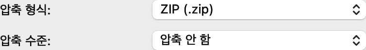

# M7 Increment 340 — 압축 수준과 선택 복원

상태: 구현·로컬 검증 완료. M7 정식 출시는 미완료다.

[고정 원본 압축 생성 창](https://github.com/files-community/Files/blob/99951c66928c4da714da8b1dd46039421182cbab/src/Files.App/Dialogs/CreateArchiveDialog.xaml.cs)은 Ultra·High·Normal·Low·Fast·None을 제공하고 선택을 설정에 저장한다. macOS 저장 창에도 최고·높음·보통·낮음·빠르게·압축 안 함을 제공하며 기본값은 보통이다. 선택한 수준은 창을 취소해도 다음 창과 재기동에 유지한다.

ArchiveCompressionLevel을 생성 API와 진행 창에 전달한다. libarchive 수준 9·7·5·3·1에 대응하며 압축 안 함은 ZIP store·7z copy를 명시적으로 사용한다. 7z의 수준 0만 설정해 압축 해제로 간주하지 않는다. [libarchive 공식 옵션 문서](https://github.com/libarchive/libarchive/blob/v3.7.7/libarchive/archive_write_set_options.3). 옵션 설정이 거부되면 다른 수준으로 조용히 대체하지 않고 기존 오류 경로로 중단한다. 기존 API 호출의 생략값은 엔진 기본 동작을 유지한다. 원본의 SevenZip 엔진과 출력 바이트나 동일 성능을 보장한다는 의미는 아니다.

수준 선택은 기존 설정 내보내기/가져오기에 선택 필드를 추가했다. 이전 설정 파일은 보통을 사용하며 잘못된 값은 전체 가져오기를 거부하고 기존 메모리·저장 설정을 유지한다. 로컬 저장소의 유효하지 않은 값은 보통으로 복원한다. 판별 가능한 열거형만 API에 전달한다. 앱의 기존 원본 보호·임시 출력 정리·게시 충돌·취소 정책은 유지한다.

ZIP·7z 각각 여섯 수준으로 한글 파일을 생성하고 다시 추출해 원본과 비교한다. ZIP은 실제 헤더의 저장/deflate 방식도 확인하며 두 포맷 모두 저장 모드의 크기와 최고 압축 결과의 차이를 검사한다. 설정은 재생성·내보내기·가져오기·이전 형식·손상 값 거부를 확인한다. 실제 팝업 선택을 재개방 상태 및 ZIP 저장 방식·7z 최고 수준 생성에 연결해 검사한다.

암호·분할·사전 크기·워드 크기·스레드·메모리 추정과 전체 원본 UI 동등성은 아직 미완료다. 인증서·공증 프로필은 사용자 준비 중이며 실제 입력·VoiceOver·두 CPU/지원 환경·장시간 수용도 남아 있다.

[압축 생성 옵션 세부 대응표](../../reference/ARCHIVE_OPTIONS_PARITY.md)에 원본의 모든 표시 옵션과 현재 구현/미구현을 분리했다. 포맷 선택의 설정 복원도 남은 항목으로 기록했다. 기존 설정 143행의 구조 감사로 이 세부 옵션 전체 완료를 주장하지 않는다.

최종 Debug·Release 빌드, Swift 전체 391개 중 성공 372개·환경 건너뜀 19개, 네 조합 전체 UI 각각 312개·탭 경계 각각 18개, parity 구조 감사와 검증 스크립트 구문 검사가 통과했다. 새 Core 함수는 설정 왕복 한 개와 두 포맷을 인자로 받는 함수 한 개이며, 후자는 여섯 수준씩 총 12회 실제 생성·추출을 수행한다. UI 개수는 기존 310개에 기본 수준과 선택/재개방 검사 두 개를 추가한 것이며 수용률이 아니다. 기존 생성 검사는 ZIP 저장 방식과 7z 최고 수준 전달을 확인하도록 강화했다. [검증 해시와 결과](archive-level-340-verification.json).

첫 빌드에서 C shim에 새 옵션 함수 선언이 없어 컴파일이 실패했다. 공개 함수 원형을 추가한 뒤 최종 빌드·실제 두 포맷 테스트가 성공했다. 파일 이동·메타데이터 정책은 변경하지 않아 별도 볼륨 재마운트 검증은 반복하지 않았다. 환경 건너뜀을 통과로 집계하지 않는다.

