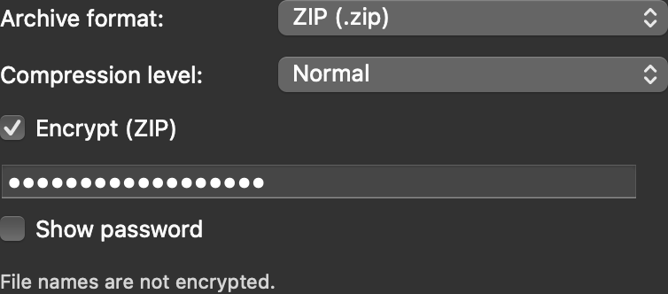

# M7 Increment 342 — ZIP 암호 생성·추출 UI

상태: 구현·최종 로컬 검증 완료. M7 정식 출시는 미완료다.

341단계 AES-256 서비스를 실제 생성·개별 추출·일괄 추출 창에 연결했다. 생성 저장 창에는 암호화 (ZIP) 선택과 secure 입력, 암호 표시 전환을 추가한다. 암호가 비어 있거나 NUL을 포함하면 저장 검증에서 거부하고, 암호화가 켜져 있으면 7z 항목을 비활성화하며 프로그램에서 강제로 선택해도 ZIP을 유지한다. 암호를 요구하면서 평문 7z를 만드는 전환은 하지 않는다. 암호는 설정에 저장하지 않는다. 파일 이름은 암호화되지 않는다는 안내를 생성 옵션에 표시한다.

공통 입력 뷰는 표시를 전환할 때 현재 입력을 새 필드로 옮기고 이전 필드를 비운다. 표시를 끄면 plain 필드를 비우고 secure 필드로 돌아온다. 생성 창 확인·취소와 암호화 해제에서 입력을 비운다. 생성기는 옵션에서 가져온 암호를 기존 진행 창과 서비스에 전달한다. 이 설명은 UI 필드 정리이며 Swift/C 메모리의 즉시 소거 보장은 아니다.

개별/일괄 추출은 실제 항목의 isEncrypted를 감지하면 파일 이름을 표시하는 별도 암호 시트를 연다. 빈 암호에서는 추출 버튼이 비활성화된다. 입력창 취소 또는 작업 취소는 시트를 닫고 필드를 비우며 추출 전 중단한다. 일괄 작업은 암호를 요청한 뒤 하위 폴더를 만들며 암호를 다음 파일에 자동 재사용하지 않는다. 암호 오류 뒤에는 사용자가 다시 추출해 새 암호를 입력할 수 있다. 데이터 읽기 오류에는 암호·파일 확인 안내를 제공하고 대상 충돌 등 다른 오류는 기존 메시지를 유지한다.

ZIP AES-256의 사용자 경로를 연결해 ZIP password capability를 활성화했다. 7z/RAR 암호 작업은 미지원으로 명시하고 미지원 경로에서 암호 입력을 요청하지 않는다. 독립 구현과의 호환성·최소 macOS·최신 두 CPU 수용은 남아 있으며 모든 ZIP 암호 변형의 지원을 의미하지 않는다.

코드 검토에서 일괄 추출의 후속 파일 목록 조회가 실패하면 직전 암호 맥락이 남을 수 있어 파일마다 초기화했다. 회귀에는 암호 파일을 추출한 뒤 손상된 일반 ZIP에서 중단하는 경우를 추가했다. 이미 추출한 결과를 보존하고 일반 파일 오류를 암호 오류로 표시하지 않는지 확인한다.

## 검증 범위

전체 UI에 여섯 검사를 추가했다. 생성 암호 유효성·포맷 제한, 표시 전환/입력 정리, 실제 암호 생성, 개별 추출의 틀린 암호/올바른 재시도, 시트 취소/작업 중단, 암호 ZIP과 일반 ZIP의 혼합 일괄 추출·틀린 암호·취소·후속 손상 파일을 확인한다. 실제 AppKit 컨트롤과 NSAlert 시트 동작을 호출하는 검사이며 물리 키보드/마우스나 VoiceOver 수용은 아니다. 새 캡처는 암호가 마스킹된 구성요소이며 전체 원본 대화상자의 동일 크기·배율 대조를 대신하지 않는다.

암호가 테스트 보고서·진행 메시지·설정 내보내기에 들어가지 않도록 기존 서비스 전달 경로를 유지한다. Core 암호 검사는 341단계의 잘못된 암호·변조·취소·충돌 보존을 유지하고 ZIP capability의 새 값을 확인한다. 원본 전체 압축 옵션·7z/RAR 암호·실제 입력/VoiceOver·외부 서비스·지원 환경·장시간·정식 서명/공증 게이트는 미완료다. 인증서·공증 프로필은 사용자 준비 중이다.

최종 Debug·Release 빌드와 네 언어/테마 조합 전체 UI 각각 318개·탭 경계 각각 18개가 통과했다. Core 전체 395개 중 성공 376개·환경 건너뜀 19개, parity 구조 감사·검증 스크립트 구문 검사도 통과했다. Core 실행 뒤 수정한 부분은 Mac의 파일별 오류 맥락 초기화와 그 UI 회귀이며 Core 소스는 유지했다. 첫 네 조합 검증 후 이 경로를 보완했고 별도 최종 바이너리로 네 조합 전체를 다시 검증했다. [소스·바이너리·보고서·마스킹 캡처 해시](archive-password-ui-342-verification.json). 기본 전송·메타데이터 정책을 바꾸지 않아 별도 볼륨 재마운트는 반복하지 않았다.

이전 b57d3e4 ARM 원격 보고서는 네 조합 전체 UI 각각 312개/경계 18개 모두 성공했다. 작업은 이후 Spotlight 시험 볼륨 정리의 소유 마운트 불일치로 실패했다. 새 암호 UI의 원격 수용이나 전체 작업 성공으로 집계하지 않으며 소유권 검사를 완화하지 않는다. 실제 hdiutil/diskutil 매핑과 소유 UUID 대조가 남아 있다. 이전 Intel 빌드 20분 제한과 최신 두 CPU·지원 환경·장시간·실제 입력·정식 서명/공증도 열린 게이트다.
