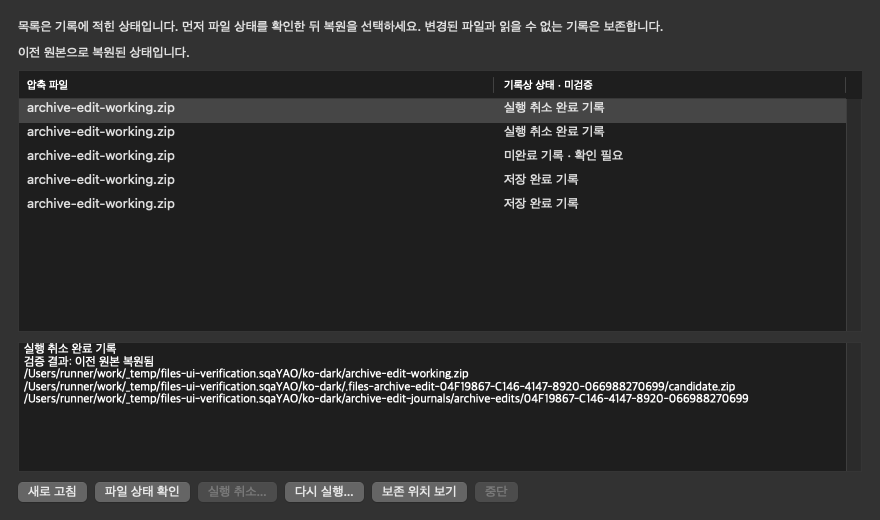
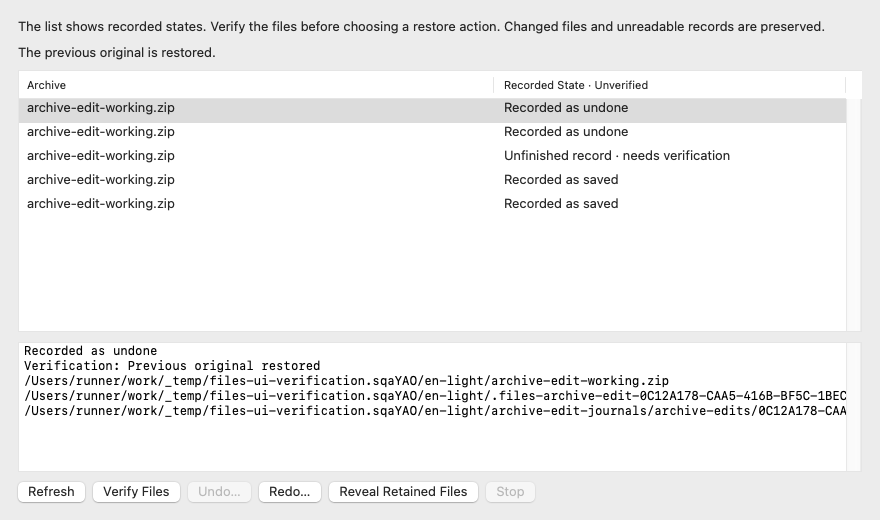

# 381 — 탐색·기록 표시 실제 수용과 암호 재시도 진단

앞선 d2f9eff의 [45877111686](https://github.com/taro6222/files-for-mac/actions/runs/45877111686) ARM 보고서와 캡처를 보존했다. 세 언어/외형 조합은 전체 361개를 통과했고 en-light는 `sevenZipEncryptedBrowseAndRetry` 한 건만 실패했다. 네 조합 모두 편집/Redo/기록 29개가 통과했고 다중 창·남은 창 사용·일괄 배치도 통과했다. 각 조합 5회 복귀의 실제 행 수는 모두 10,001개다. 378의 탐색 fixture 격리가 실제로 확인됐다.

복구 상세 영역의 실제 경로 표시와 배경색/버튼도 대표 캡처에서 확인했다. 이 자료는 d2f9eff의 결과이며, 이후 추가된 빈 ZIP/빈 암호 7z 선택 흐름의 8개를 검증한 자료로 사용하지 않는다. 전체 실행은 해당 암호 재시도 실패 때문에 성공이 아니다. Intel은 기존 실행을 유지한다.

| 프로필 | 전체 조건 | 실패 |
|---|---:|---|
| ko-light | 361 | 없음 |
| ko-dark | 361 | 없음 |
| en-light | 361 | 7z 암호 재시도 |
| en-dark | 361 | 없음 |

[보존한 실제 보고서](ui-381-arm/en-light-report.json)와 [보고서/이미지 hash](archive-ui-evidence-381.json)를 연결한다.

## 미해결 실패의 진단

기존 암호 재시도 검사는 false 한 값만 남겨 틀린 암호와 올바른 암호 중 어느 시도가 실패했는지 알 수 없었다. 각 시도의 성공 기대값, prompt 표시, 실행 여부, 입력 정리 여부, 항목 수, 상태 문구, 경과 시간을 추가 기록한다. 실제 암호 값은 기록하지 않는다. 기존 5초 prompt/10초 완료 기한·항목 수·지역화 오류 안내·입력 정리 조건과 369개 검사는 유지한다. 실패를 자동 재시도해 감추지 않는다. 원인과 수정 완료로 판정하지 않는다.

진단 코드의 로컬 Debug 33.20초 빌드, 기존 검사 대입 키/순서 일치와 공백 검사를 통과했다. 변경은 DEBUG 검증 함수 안이며 Release/Core/SDK는 유지한다. 이 진단이 포함된 원격 결과는 아직 없다. 새 전체 CI를 중복 시작하지 않고 현재 실행의 실제 결과부터 확인한다.

## 최신 실행과 종료 기록

최신 62f8d40의 [45879436288](https://github.com/taro6222/files-for-mac/actions/runs/45879436288) ARM Debug는 194.224초 후 returnCode 0으로 통과했고 Swift/SDK·파일 시스템 회귀 뒤 실제 UI 단계에 들어갔다. 이전 Swift 6.2 컴파일 오류가 해결된 첫 원격 증거다. Intel/전체 UI/번들·프리뷰 수용은 진행 중이며 종료 없이 성공으로 집계하지 않는다.

컴파일 오류가 이미 확인된 b41087a의 [45878584565](https://github.com/taro6222/files-for-mac/actions/runs/45878584565)는 수정 소스 실행 후 불필요한 Intel 빌드를 중단했다. ARM failure/Intel cancelled와 전체 cancelled의 실제 종료를 확인하고 Intel 로그 285,143바이트와 job metadata를 로컬 build에 보존했다. 관찰 시간 초과 때문에 재시작한 작업은 없다.

F23/M7 전체 완료는 아니다. 최신 UI/암호 재시도 원인, 지원 환경·실제 입력/VoiceOver·정식 서명/공증 등이 남아 있다. 로컬 GUI·장시간 앱은 실행하지 않았다.
