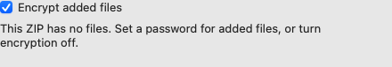

# 382 — 최신 ARM 전체 수용과 고정 Git fixture·실패 기록

62f8d40의 [45879436288](https://github.com/taro6222/files-for-mac/actions/runs/45879436288)는 ARM 작업 전체가 성공하고 Intel이 실패해 전체 실행은 실패다. ARM의 실제 네 언어/외형 조합은 각각 **369/369**, 별도 탭 경계는 각각 **18/18** 통과했다. 빈 ZIP 암호 선택/취소·명시적 해제와 빈 암호 7z 헤더 보호도 실제 UI에서 통과했다. 이전에 간헐 실패한 7z 암호 재시도는 이번 ARM 네 조합에서 재현되지 않았으나 원인 해결로 판정하지 않는다.

ARM 패키지 보고서의 Swift 74개·격리 helper 113개·진단 SDK 205개·native 편집 85개·권한 15개가 모두 통과했다. 설치 프리뷰의 DMG 생성·마운트·복사/검증·시작·Launch Services 확인도 해당 CI step 성공으로 확인했다. ad-hoc 프리뷰 검증이며 Developer ID/공증 수용이 아니다.

[네 조합 실제 보고서](ui-382-arm/en-light-report.json), [탭 경계 보고서](ui-382-arm/tabs-en-light-report.json), [소스/보고서 hash](archive-ui-acceptance-382.json)를 보존했다.

## Intel 실패 구분

Intel은 전체 AppKit 전의 종합 파일 작업 UI에서 `gitCloneTimeoutCleanup` 조건이 false였다. 선행 볼륨 검사는 통과했지만 이 UI 실패로 이후 전체 UI·프리뷰는 실행하지 않았다. 기존 로그에서 추출한 [종합 UI 보고서](m2-382-intel-log-derived.json)를 보존하며 원본 job log hash를 기록했다. 당시에는 내부 취소 검사 report/스택이 artifact에 보존되지 않아 어느 세부 조건이 실패했는지 확정하지 않는다.

이전 d2f9eff [45877111686](https://github.com/taro6222/files-for-mac/actions/runs/45877111686)도 양 CPU 실패로 종료됐다. Intel ko-dark는 Git clone 20초 초과, en-dark는 컬럼 탐색 세 조건 실패였고 나머지 두 조합은 각각 361개 통과했다. ko-dark의 실제 자식 스택은 checkout의 `write_entry → close`에 대부분 머물렀다. 당시 UI가 현재 프로젝트 전체를 복제해 입력 규모가 개발 기록/이미지 증가에 따라 바뀌고 있었다.

## 검증 도구 수정

`create-ui-git-fixture.py`로 35개 고정 파일과 main 커밋을 가진 로컬 bare 원격을 만든다. 전체 UI가 이를 실제 Git으로 복제하고 `.git`/콜백 위치에 더해 모든 파일 내용과 README 커밋 SHA도 확인한다. 기존 20초 clone 기준은 유지하며 큰 저장소 성능 전체를 이 작은 fixture로 보증하지 않는다. 테스트 목적은 계획 T18의 실제 bare 복제·ref/내용과 UI 연결이다. 다른 Git/볼륨 조건을 제거하지 않았다.

생성기는 새 출력에만 쓰며 사용자 Git 설정을 변경하지 않는다. 생성 명령은 15초 기한·실패 시 자식 그룹 회수를 갖는다. CLI 실제 복제의 35개 내용·동일 commit·깨끗한 작업 트리를 확인했고, 기존 출력 재지정은 실패하며 기존 manifest가 보존됐다.

컬럼 실패는 원인이 미확정이므로 초기/기본 선택/하위 선택/왼쪽 이동의 실제 열 위치·행 수·선택·처음 이름을 기록한다. 기존 선택/5초 기한/성공 조건은 유지한다.

Git 취소 검사의 기존 논리 조건을 개별 결과로 기록하고 시작 실패도 남긴다. 종합 UI temp 경로를 runner.temp로 고정해 항상 report·run log·캡처·해당 취소 검사 report/스택을 업로드한다. 전체 UI용 Git fixture manifest/설정 로그도 보존한다. 진단 자체가 취소 버그를 해결했다고 판정하지 않는다.

## 로컬 검증과 남은 수용

최종 DEBUG 빌드 7.55초, Python/YAML/쉘 구문·기존 단계 제한·공백 검사를 통과했다. 변경한 Swift 줄은 모두 DEBUG 범위임을 비교해 Release 앱 코드가 같음을 확인했다. Core/SDK/Release가 바뀌지 않아 해당 회귀를 반복하지 않았다. 369개 전체 UI 조건을 유지하며 clone 조건은 내용/ref 비교로 강화했다.

이 검증 도구 변경 후 실제 원격 수용은 미완료다. 최신 소스는 이 단계 커밋 후 한 번만 검증한다. 로컬 GUI·장시간 앱은 실행하지 않았다. Intel 취소/컬럼·간헐 암호 재시도·지원 환경·실제 입력/VoiceOver·정식 서명/공증과 F23/M7 전체 수용은 여전히 남아 있다.
